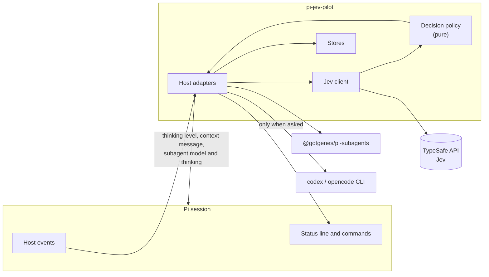
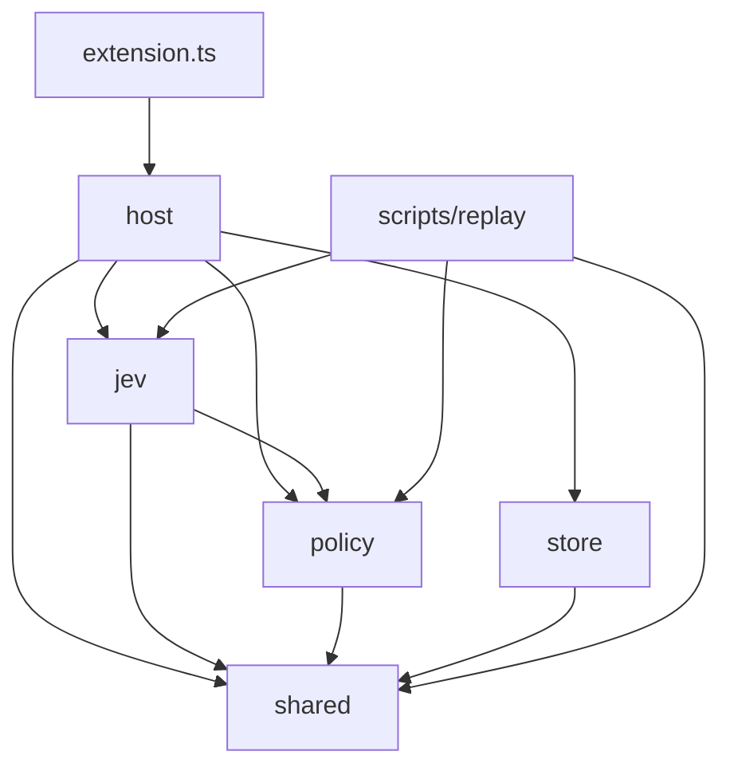

# Architecture

## Overview

pi-jev-pilot is one Pi package with one extension. It watches a few host events, asks Jev typed questions, turns the answers into decisions with deterministic rules, and applies them through public Pi APIs.

Jev never controls anything directly. **Code owns the control flow; Jev only answers questions.**



## Principles

1. **Public host APIs only.** No patches, no undocumented metadata. See [ADR 0001](decisions/0001-public-host-apis.md).
2. **Fail open.** Any classifier failure leaves Pi behaving as if the package were absent.
3. **Pure policy.** Every decision rule is a function of its inputs, with no Pi imports and no I/O, so it can be tested and replayed offline.
4. **Rubrics are data.** Tier descriptions live in data, not in logic. Modes are target tables; cut points are computed from the ledger. See [ADR 0008](decisions/0008-mode-target-cutpoints.md).
5. **Decide on probabilities.** `confidence` is logged, never a gate. See [ADR 0002](decisions/0002-probabilities-not-confidence.md).
6. **Nothing automatic is hidden.** Every automatic change shows a line and can be undone.

## Module layout

```text
src/
  extension.ts              Entry point. Calls setup() from host/setup.ts. No logic.

  policy/                   Pure. No Pi imports, no I/O. One folder per capability.
    answers.ts              Validates a raw response, per question (shared by several capabilities)
    effort.ts               Effort rules: risk floor, ceiling, fast-tier cap
    launch.ts               Effective launch fields and locks
    main/
      index.ts              Entry point for other folders
      hold.ts               Whether a main prompt keeps its effort
      ledger-line.ts        Main and correction ledger lines, hold anchor
      outcome.ts            Classifier outcome to record fields, effort target and advice
      record.ts             Per-turn bookkeeping, written to ledger lines when the run settles
      skill.ts              Skill criteria, batches, pick, delivery text, duplicate check
      strategy.ts           Advice gates and advice text
    review/
      index.ts              Entry point for other folders
      cli.ts                CLI commands, model catalogs, tier names, result text
    tools/
      index.ts              Entry point for other folders
      assess.ts             Candidates, the 32 cap, the flag threshold
    tuning/
      index.ts              Entry point for other folders
      rules.ts              Tuning rules: step, revert, undo, reset, off
      signals.ts            Signals per mode over the latest 200 decisions (observed only)
      text.ts               Change lines, session-start line, report text
      window.ts             Decision counting: order, window, p90, shares
    worker/
      index.ts              Entry point for other folders
      answers.ts            Reads worker answers
      cut-window.ts         Which ledger lines are eligible; window size
      cutpoints.ts          Cut points from a window
      ledger-line.ts        Worker ledger line fields
      modes.ts              Mode names, target tables
      route.ts              Launch route: untouched checks, thinking-only, fallback, clamp
      score.ts              Difficulty score
      seed.ts               Seed cut points (data)
      tier.ts               Model decision order

  shared/                   Dependency-free rules used by more than one module
    text.ts                 Code-point cut
    urls.ts                 The Jev URL rule

  jev/                      Talks to TypeSafe.
    branch.ts               Reads Pi-shaped session entries into branch items
    client.ts               Transport: timeout, abort, no redirects
    questions.ts            Builds the questions for each request kind
    rubrics.ts              Worker and main rubric text (data), RUBRIC_VERSION
    state.ts                Builds main, worker and tool state from plain inputs
    workspace.ts            Reads platform markers by file name

  host/                     Everything that touches Pi or the executor. One folder per capability.
    setup.ts                Wires the handlers and /jev; the only file extension.ts imports
    main/
      index.ts              Entry point for other folders
      apply.ts              Applies an outcome plan: thinking level and status
      catalog.ts            Skill catalog, explicit skill, loaded-in-context scan
      create.ts             createMain: wires the main handlers, owns no logic
      gate.ts               Whether a turn is decided, what it asks, the new record
      host.ts               MainDeps, shared handler context, status drawing
      rich.ts               Builds the optional rich state inputs for the shipped groups
      session.ts            MainSession: the turn in flight, status decision, overlay
      settled.ts            agent_settled: correction, main and jev-turn lines; abort undo
      skills.ts             Skill later batches, pick and the hidden skill message
      start.ts              before_agent_start: gate, ask Jev, apply the reply
    platform/
      index.ts              Entry point for other folders
      agents.ts             Reads agent files and the built-in agent table
      child.ts              Child registry
      context.ts            Previous turn id and hold context from the branch; re-exports
                            branchItems and scanPlatforms from jev/
      main-cwd.ts           Cwd of the newest main session, for the directory mode
      models.ts             Model id helpers shared by worker routing and slot commands
      readiness.ts          Key and executor checks; snapshot of config and state
      stores.ts             Directory holding the package's files
    status/
      index.ts              Entry point for other folders
      line.ts               Status line, tally, log entries
      tally.ts              In-memory session observer fed by validated ledger lines
    tools/
      index.ts              Entry point for other folders
      assessment.ts         Worker-side tool assessment: record lookup, request, flag, removal
      counts.ts             Hands the counts to the worker ledger line
      facts.ts              Maps Pi tool info to plain tool facts
      service.ts            Captures the executor service at main session_start
    tuning/
      index.ts              Entry point for other folders
      command.ts            /jev tune: report, undo, reset, on, off
      deps.ts               Dependencies of the tuning handlers
      seen.ts               Session-start line for unseen changes, `seenAt`
      step.ts               agent_settled step: skip rules, write, change lines
    worker/
      index.ts              Entry point for other folders
      cutpoint-window.ts    In-memory window of the latest eligible worker lines
      routing.ts            message_end batch; tool_call route and mutation; warnings; ledger join
    review/
      index.ts              Entry point for other folders
      tool.ts               jev_review tool, runs the CLI, hides the tool in children and while off
    commands/
      index.ts              Entry point for other folders
      jev.ts                /jev command entry point
      local-mode.ts         The directory mode command
      slots.ts              The /jev custom model slot forms: add or replace, show, remove

  store/                    Files under <agentDir>/jev/. Flat.
    atomic.ts               Atomic write: owner-only directory and file
    config.ts               config.json: reads and validates; writes only crew.slots
    defaults.ts             Default values and feature and mode names
    ledger-schema.ts        Ledger line schema and field lists
    ledger.ts               ledger.jsonl: append, rotate, read
    local-mode.ts           <cwd>/.pi/jev-mode.json: reads and writes the directory mode
    settings.ts             Effective settings: directory (mode only) > tuning > state > config > default
    state-file.ts           state.json: switches, mode, CLI review default and on/off
    tuning-file.ts          tuning.json: changes, history
    validate.ts             Small validators that collect issues with field paths

scripts/
  replay/                   Offline measurement. Output stays outside the repository.
    cli.ts                  Entry point: dry run by default, --send to call Jev
    compare.ts              Aggregates flips against rerun noise
    config.ts               Argument parsing and plain-JSON config reading
    corpus.ts               Main-turn and worker samples, seeded stratified sampler
    inputs.ts               Rebuilds rich state inputs from local data
    outputs.ts              Owner-only output files; nothing here decides or aggregates
    report.ts               Plans the report pass: one report and one rerun per request
    report-compare.ts       Pure aggregation of the report pass: the run against its rerun
    report-route.ts         Pure per-mode, per-routing worker routing for the report pass
    run.ts                  Sends planned requests, estimates cost
    sessions.ts             Reads Pi session files and ledger lines
    variants.ts             Plans the variants of each pass
```

### Dependency rules



- `policy/` imports nothing outside itself and `shared/`.
- A capability folder (a direct subfolder of `host/` or `policy/`) is used from outside only through its `index.ts`, with named re-exports.
- Relative imports take the shortest path. A round trip such as `../main/x.ts` from inside `main/` is a violation.
- Capability folders nest at most one level. `jev/`, `store/` and `shared/` stay flat.
- Pure decision rules and data transforms live in `policy/`. Mutable shell state stays in `host/`.
- `bun run test` runs `tests/import-graph.test.ts`, the authoritative check; it resolves every import path. `bun run lint` gives early feedback on the plain spellings.
- `shared/` imports nothing outside itself; any module but `extension.ts` may import it.
- `jev/` knows nothing about Pi. It receives plain inputs, which is what lets `scripts/replay` reuse it.
- `store/` knows files and schemas, nothing about decisions.
- Only `host/` imports `@earendil-works/pi-coding-agent` or reads executor events.


## Host seams

Each row is a public contract the package relies on. Rows marked **Verified** were confirmed by [WG-02](roadmap.md#wg-02-host-seam-verification); see the [evidence report](evidence/2026-11-05-host-seams.md).

| Purpose | Seam | Status |
|---|---|---|
| Decide before a main turn | `pi.on("before_agent_start")` | Documented |
| Add skill and advice to context | `before_agent_start` returning `message` with `display: false` | Documented |
| Set main effort | `pi.setThinkingLevel`, `clampThinkingLevel` | Documented |
| Read recent conversation | `ctx.sessionManager.getBranch()` | Documented |
| Skill catalog | `pi.getCommands()` with `sourceInfo.path`, `parseFrontmatter` / `stripFrontmatter` | Documented |
| Skills already in context | `ctx.sessionManager.buildSessionProjection()` | Documented |
| Pre-classify sibling launches | `pi.on("message_end")` before `tool_call` preflight | Verified: yes ([Q2](evidence/2026-11-05-host-seams.md#q2)) |
| Set worker model and thinking | `pi.on("tool_call")` mutating `event.input` | Documented. Verified: yes, it reaches the child ([Q1](evidence/2026-11-05-host-seams.md#q1)) |
| Detect a child session | `subagents:child:session-created` on `pi.events` | Verified: yes ([Q4](evidence/2026-11-05-host-seams.md#q4)) |
| Remove tools in a child | Child `before_agent_start` editing `systemPromptOptions.selectedTools` | Verified: yes ([Q3](evidence/2026-11-05-host-seams.md#q3)) |
| Worker outcome | `subagents:completed`, `subagents:failed` | Documented by the executor |
| Tool metadata | `pi.getAllTools()` | Documented |
| Model existence and credentials | `ctx.modelRegistry` | Documented |
| Know whether a provider request started | `pi.on("before_provider_request")` | Documented. A run that settles aborted with no request restores the replaced thinking level on Esc ([evidence](evidence/2026-11-05-host-seams.md#before_agent_start-signal-wg-07)) |
| Idle moment for tuning; end of a turn (ledger line, Esc restore) | `pi.on("agent_settled")` | Documented |
| After a compaction | `pi.on("session_compact")` | Documented |
| Display | `ctx.ui.setWidget`, `pi.appendEntry`, `pi.registerEntryRenderer` | Documented |
| CLI review | `pi.registerTool`, `pi.exec` | Verified by host test `tests/host/cli-review.test.ts` (fake `codex` and `opencode` on `PATH`) |
| Find a worker's launch | Executor service `listAgents()` matched by `outputFile`, captured at main `session_start` | Verified by host test `tests/host/tool-assessment.test.ts` ([evidence](evidence/2026-11-05-host-seams.md#tool-assessment-service-lookup-wg-14)) |
| Hide the review tool in a child | Child `before_agent_start` editing `systemPromptOptions.selectedTools` (the Q3 seam) | Verified by the same host test: absent in a child's request |

## Runtime contexts

A child session binds the parent's extension set and runs in the same process, so the extension runs twice:

| | Main session | Child session (worker) |
|---|---|---|
| Effort, skill, advice | Yes | No |
| Worker routing | Yes | Not possible: the executor removes `subagent` |
| Tool assessment | No | Yes |
| Status line, tally | Yes | No |
| Review tool | Yes | Not offered: removed from `selectedTools` in `before_agent_start`, and refused if called |

**Child detection.** The extension subscribes to `subagents:child:session-created`, which the executor publishes before binding the child's extensions, and keeps child session ids in a registry on `globalThis` under a `Symbol.for` key, because the two extension instances do not share module state. The registry also drops an id on `subagents:child:disposed`, and each instance unsubscribes on `session_shutdown`. Every handler checks `ctx.sessionManager.getSessionId()` against it first. `@gotgenes/pi-permission-system` uses the same pattern. Visibility, timing and id match are verified ([Q4](evidence/2026-11-05-host-seams.md#q4)).

Without the executor installed, nothing counts as a child, and worker routing and tool assessment are off with a note in `/jev`.

## Display surfaces

| Surface | How | Content |
|---|---|---|
| Status line | `ctx.ui.setWidget` above the editor, right-aligned in the terminal UI, only when `ctx.hasUI`. Separate from the executor's agents widget | `Jev · standard · high · parallel 72% · 2 workers` |
| Base states | Drawn from WG-06 as `Jev · <mode>` (`Jev · <mode> (local)` under a directory mode), `Jev · no key`, `Jev · config error` or `Jev · off`. First that applies: config error > no key > off > mode. `/jev status off` clears the line. Nothing is drawn in print or JSON mode | `Jev · standard` |
| `/jev` output | `ctx.ui.notify` only, so nothing is printed without a UI | Status, features, key, executor, problems |
| Tally | At the end of `/jev`, and on the status line every 10th prompt (replaces the level and advice suffixes for that prompt) | Prompts, workers by model, tokens on workers, fallbacks. Counts only, no dollars. Tools flagged arrives with WG-14 |
| Log | Only while `verbose` is on. `pi.appendEntry("jev-log")` with `registerEntryRenderer`, not sent to the model | `jev · general-purpose → balanced · high · 0.5s` |
| Verbose | Turns the log on. Lines carry raw probabilities, and why something was skipped | Errors always show |
| Effort difference | Shown when clamping changed a level | `requested → effective`, such as `xhigh → high` |

## Failure model

| Failure | Effect on work | Visible as |
|---|---|---|
| No API key | None; package inert | Status line: `Jev · no key` |
| Jev timeout, HTTP error, unreadable response | None; turn or launch proceeds unchanged | Status line; ledger `miss` |
| One invalid answer in a response | Other answers still count | Verbose log |
| User cancels (Esc) | Everything stops; no fallback runs | Normal Pi behavior |
| Esc before the first provider request | Pi aborts the run; the package puts back the replaced thinking level (if still the one it set) | No ledger line |
| Malformed `config.json` | Package inert; file untouched | Error naming the field |
| Malformed `state.json` | Defaults apply; file moved to `state.json.bad` on the next change | Problem reported to `/jev` |
| Unreadable `state.json` | Defaults apply; file left alone, changes refused | Problem reported to `/jev` |
| Malformed or unreadable `<cwd>/.pi/jev-mode.json` | Global mode applies; file left alone; `/jev mode <m>` overwrites it | `local mode (malformed)` or `local mode (unreadable)` in `/jev` |
| Tier model unavailable | Next lower tier, with a warning shown once per tier and model per session | Warning; ledger `fallback` |
| Slot model unavailable | `balanced`, then `fast`, with a warning naming `crew.slots "<name>" model` | Warning; ledger `fallback` |
| Nothing can run | Input unchanged | Warning |
| Agent file locks the model | Only thinking is written; the tier is recorded | Ledger `locked` |
| Tool assessment fails | Worker keeps all tools | Nothing (counts omitted) |
| Worker fails while running | Reported by the executor; **not retried** | Ledger `status` |
| CLI review fails | Tool result says the review did not run, with the reason and the error tail; no other reviewer is tried | Tool result |
| Ledger write fails | Decision still applied | Verbose log |

## Data flow boundaries

- Outbound to TypeSafe: see [Privacy](privacy.md). All state is built in `jev/state.ts`, the single place to audit.
- Stored locally: labels, numbers and outcomes. The ledger schema rejects free text beyond short identifiers.
- Directory mode: `<cwd>/.pi/jev-mode.json` holds exactly `{"version":1,"mode":"<m>"}`, written atomically. It is never sent to the model, no other project file is touched, and nothing is written to `state.json` or `config.json`.
- Secrets: read from the environment at call time, never written anywhere.

## Performance budget

| Moment | Added wait |
|---|---|
| Each main prompt | Typically about 0.5 s, at most `timeoutMs` (1500 ms) |
| Each message with subagent launches | One concurrent batch, at most `timeoutMs` |
| Tool assessment | Runs inside the worker; the worker waits up to `timeoutMs` before its first turn, in both modes. The main session does not wait |
| Everything else | None. Commands never call Jev |

## Not in the architecture

Main-model routing, mid-turn effort changes, worker retries, automatic reviews, a local proxy and health probing are deliberately absent. See the [project brief](project-brief.md#non-goals).
