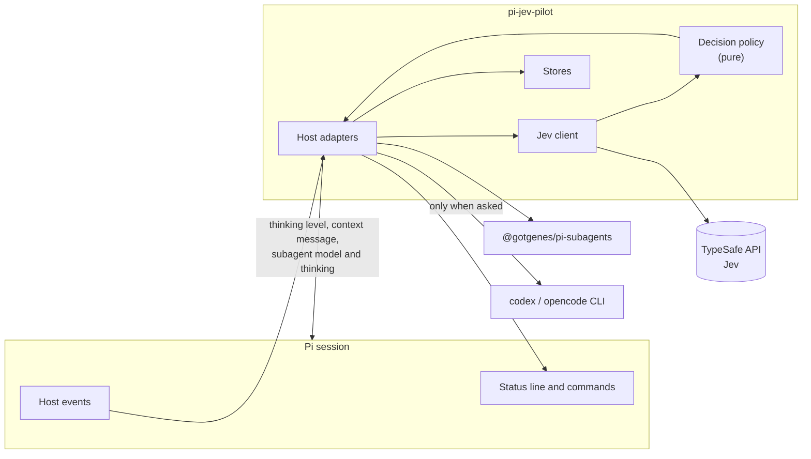
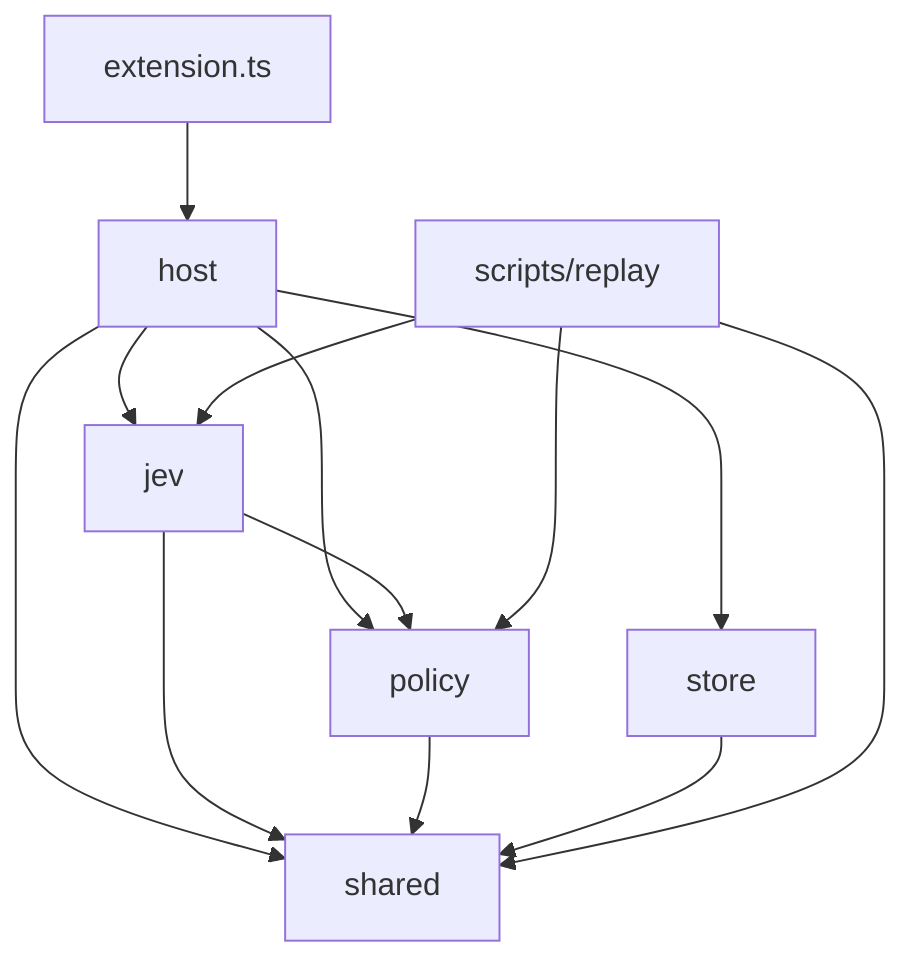

# Architecture

## Overview

pi-jev-pilot is one Pi package with one extension. It watches a few host events, asks Jev typed questions, turns the answers into decisions with deterministic rules, and applies them through public Pi APIs.

Jev never controls anything directly. **Code owns the control flow; Jev only answers questions.**



## Principles

1. **Public host APIs only.** No patches, no undocumented metadata. See [ADR 0001](decisions/0001-public-host-apis.md).
2. **Fail open.** Any classifier failure leaves Pi behaving as if the package were absent.
3. **Pure policy.** Every decision rule is a function of its inputs, with no Pi imports and no I/O, so it can be tested and replayed offline.
4. **Rubrics are data.** Tier descriptions live in data keyed by mode, not in logic. See [ADR 0003](decisions/0003-rubric-per-mode.md).
5. **Decide on probabilities.** `confidence` is logged, never a gate. See [ADR 0002](decisions/0002-probabilities-not-confidence.md).
6. **Nothing automatic is hidden.** Every automatic change shows a line and can be undone.

## Module layout

```text
src/
  extension.ts           Entry point. Wires host adapters together. No logic.

  policy/                Pure. No Pi imports, no I/O.
    answers.ts           Validates a raw response, per question
    effort.ts            Effort rules: risk floor, ceiling, fast-tier cap
    launch.ts            Effective launch fields and locks
    worker.ts            Reads worker answers
    tier.ts              Model decision order
    modes.ts             Mode names, Fable rules
    skill.ts             Skill criteria, batches, pick, delivery text, duplicate check
    strategy.ts          Advice gates and advice text
    tools.ts             Which tools are assessed, which are removed
    tuning.ts            Tuning rules, revert rules

  shared/                Dependency-free rules used by more than one module
    urls.ts              The Jev URL rule
    text.ts              Code-point cut

  jev/                   Talks to TypeSafe.
    client.ts            Transport: timeout, abort, no redirects
    rubrics.ts           Rubric text per mode (data)
    questions.ts         Builds the questions for each request kind
    state.ts             Builds main, worker and tool state from plain inputs

  host/                  Everything that touches Pi or the executor.
    main.ts              before_agent_start: effort, skill, advice
    worker.ts            message_end and tool_call: model and thinking
    child.ts             Child registry; tool assessment in children
    review.ts            jev_review tool, runs the CLI, hides the tool in children
    review-cli.ts        Pure: CLI commands, model catalogs, tier names, result text
    context.ts           Reads the branch, tools, git counts, platforms
    agents.ts            Reads agent files and the built-in agent table
    commands.ts          /jev
    status.ts            Status line, tally, log entries
    readiness.ts         Key and executor checks; snapshot of config and state
    setup.ts             Wires the handlers and /jev; the entry point delegates to it,
                         because lint keeps Pi imports in host/

  store/                 Files under <agentDir>/jev/.
    config.ts            config.json: reads and validates; writes only crew.slots
    state-file.ts        state.json: switches, mode, CLI review default
    settings.ts          Effective settings: tuning > state > config > default
    defaults.ts          Default values and feature and mode names
    atomic.ts            Atomic write: owner-only directory and file
    validate.ts          Small validators that collect issues with field paths
    ledger-schema.ts     Ledger line schema and field lists
    ledger.ts            ledger.jsonl: append, rotate, read
    tuning-file.ts       tuning.json: changes, history

scripts/
  replay/                Offline measurement. Output stays outside the repository.
```

### Dependency rules



- `policy/` imports nothing outside itself and `shared/`.
- `shared/` imports nothing outside itself; any module but `extension.ts` may import it.
- `jev/` knows nothing about Pi. It receives plain inputs, which is what lets `scripts/replay` reuse it.
- `store/` knows files and schemas, nothing about decisions.
- Only `host/` imports `@earendil-works/pi-coding-agent` or reads executor events.

Lint rules enforce these boundaries where possible.

## Host seams

Each row is a public contract the package relies on. Rows marked **Verified** were confirmed by [WG-02](roadmap.md#wg-02-host-seam-verification); see the [evidence report](evidence/2026-11-05-host-seams.md).

| Purpose | Seam | Status |
|---|---|---|
| Decide before a main turn | `pi.on("before_agent_start")` | Documented |
| Add skill and advice to context | `before_agent_start` returning `message` with `display: false` | Documented |
| Set main effort | `pi.setThinkingLevel`, `clampThinkingLevel` | Documented |
| Read recent conversation | `ctx.sessionManager.getBranch()` | Documented |
| Know context usage | `ctx.getContextUsage()` | Documented |
| Skill catalog | `pi.getCommands()` with `sourceInfo.path` | Documented |
| Pre-classify sibling launches | `pi.on("message_end")` before `tool_call` preflight | Verified: yes ([Q2](evidence/2026-11-05-host-seams.md#q2)) |
| Set worker model and thinking | `pi.on("tool_call")` mutating `event.input` | Documented. Verified: yes, it reaches the child ([Q1](evidence/2026-11-05-host-seams.md#q1)) |
| Detect a child session | `subagents:child:session-created` on `pi.events` | Verified: yes ([Q4](evidence/2026-11-05-host-seams.md#q4)) |
| Remove tools in a child | Child `before_agent_start` editing `systemPromptOptions.selectedTools` | Verified: yes ([Q3](evidence/2026-11-05-host-seams.md#q3)) |
| Worker outcome | `subagents:completed`, `subagents:failed` | Documented by the executor |
| Tool metadata | `pi.getAllTools()` | Documented |
| Model existence and credentials | `ctx.modelRegistry` | Documented |
| Know whether a provider request started | `pi.on("before_provider_request")` | Documented. A run that settles aborted with no request restores the replaced thinking level on Esc ([evidence](evidence/2026-11-05-host-seams.md#before_agent_start-signal-wg-07)) |
| Idle moment for tuning; end of a turn (ledger line, Esc restore) | `pi.on("agent_settled")` | Documented |
| After a compaction | `pi.on("session_compact")` | Documented |
| Display | `ctx.ui.setWidget`, `pi.appendEntry`, `pi.registerEntryRenderer` | Documented |
| CLI review | `pi.registerTool`, `pi.exec` | Verified by host test `tests/host/cli-review.test.ts` (fake `codex` and `opencode` on `PATH`) |
| Hide the review tool in a child | Child `before_agent_start` editing `systemPromptOptions.selectedTools` (the Q3 seam) | Verified by the same host test: absent in a child's request |

## Runtime contexts

A child session binds the parent's extension set and runs in the same process, so the extension runs twice:

| | Main session | Child session (worker) |
|---|---|---|
| Effort, skill, advice | Yes | No |
| Worker routing | Yes | Not possible: the executor removes `subagent` |
| Tool assessment | No | Yes |
| Status line, tally | Yes | No |
| Review tool | Yes | Not offered: removed from `selectedTools` in `before_agent_start`, and refused if called |

**Child detection.** The extension subscribes to `subagents:child:session-created`, which the executor publishes before binding the child's extensions, and keeps child session ids in a registry on `globalThis` under a `Symbol.for` key, because the two extension instances do not share module state. The registry also drops an id on `subagents:child:disposed`, and each instance unsubscribes on `session_shutdown`. Every handler checks `ctx.sessionManager.getSessionId()` against it first. `@gotgenes/pi-permission-system` uses the same pattern. Visibility, timing and id match are verified ([Q4](evidence/2026-11-05-host-seams.md#q4)).

Without the executor installed, nothing counts as a child, and worker routing and tool assessment are off with a note in `/jev`.

## Display surfaces

| Surface | How | Content |
|---|---|---|
| Status line | `ctx.ui.setWidget` above the editor, right-aligned in the terminal UI, only when `ctx.hasUI`. Separate from the executor's agents widget | `Jev · standard · high · parallel 72% · 2 workers` |
| Base states | Drawn from WG-06 as `Jev · <mode>`, `Jev · no key`, `Jev · config error` or `Jev · off`. First that applies: config error > no key > off > mode. `/jev status off` clears the line. Nothing is drawn in print or JSON mode | `Jev · standard` |
| `/jev` output | `ctx.ui.notify` only, so nothing is printed without a UI | Status, features, key, executor, problems |
| Tally | At the end of `/jev`, and on the status line every 10th prompt | Prompts, workers by model, tokens on workers, tools flagged, fallbacks. Counts only, no dollars |
| Log | Off by default. `pi.appendEntry` with `registerEntryRenderer`, not sent to the model | `jev · general-purpose → balanced · high · 0.5s` |
| Verbose | Adds raw probabilities, and why something was skipped | Errors always show |
| Effort difference | Shown when clamping changed a level | `requested → effective`, such as `xhigh → high` |

## Failure model

| Failure | Effect on work | Visible as |
|---|---|---|
| No API key | None; package inert | Status line: `Jev · no key` |
| Jev timeout, HTTP error, unreadable response | None; turn or launch proceeds unchanged | Status line; ledger `miss` |
| One invalid answer in a response | Other answers still count | Verbose log |
| User cancels (Esc) | Everything stops; no fallback runs | Normal Pi behavior |
| Esc before the first provider request | Pi aborts the run; the package puts back the replaced thinking level (if still the one it set) | No ledger line |
| Malformed `config.json` | Package inert; file untouched | Error naming the field |
| Malformed `state.json` | Defaults apply; file moved to `state.json.bad` on the next change | Problem reported to `/jev` |
| Unreadable `state.json` | Defaults apply; file left alone, changes refused | Problem reported to `/jev` |
| Tier model unavailable | Next lower tier, with a warning | Warning; ledger `fallback` |
| Slot model unavailable | `balanced`, with a warning | Warning; ledger `fallback` |
| Nothing can run | Input unchanged | Warning |
| Agent file locks the model | Executor ignores the change | Ledger `locked` |
| Tool assessment fails | Worker keeps all tools | Verbose log |
| Worker fails while running | Reported by the executor; **not retried** | Ledger `status` |
| CLI review fails | Tool result says the review did not run, with the reason and the error tail; no other reviewer is tried | Tool result |
| Ledger write fails | Decision still applied | Verbose log |

## Data flow boundaries

- Outbound to TypeSafe: see [Privacy](privacy.md). All state is built in `jev/state.ts`, the single place to audit.
- Stored locally: labels, numbers and outcomes. The ledger schema rejects free text beyond short identifiers.
- Secrets: read from the environment at call time, never written anywhere.

## Performance budget

| Moment | Added wait |
|---|---|
| Each main prompt | Typically about 0.5 s, at most `timeoutMs` (1500 ms) |
| Each message with subagent launches | One concurrent batch, at most `timeoutMs` |
| Tool assessment | Runs inside the worker; the main session does not wait |
| Everything else | None. Commands never call Jev |

## Not in the architecture

Main-model routing, mid-turn effort changes, worker retries, automatic reviews, a local proxy and health probing are deliberately absent. See the [project brief](project-brief.md#non-goals).
