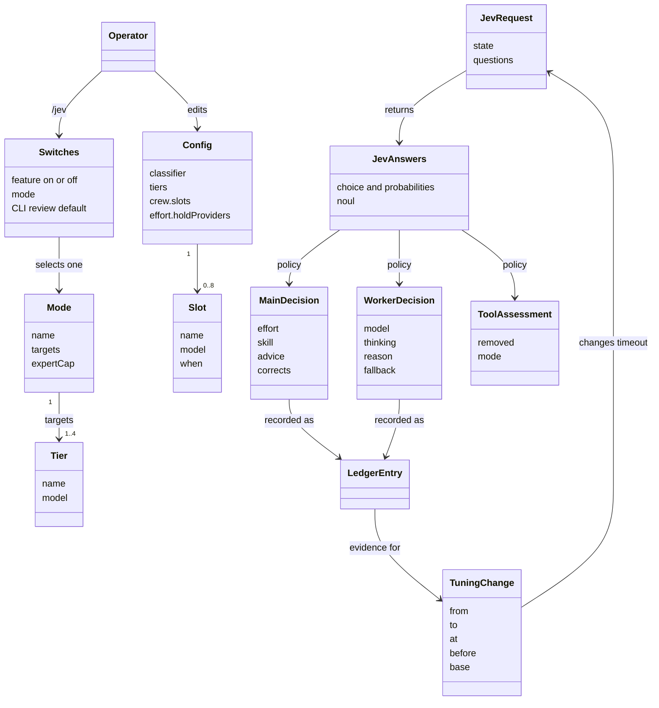
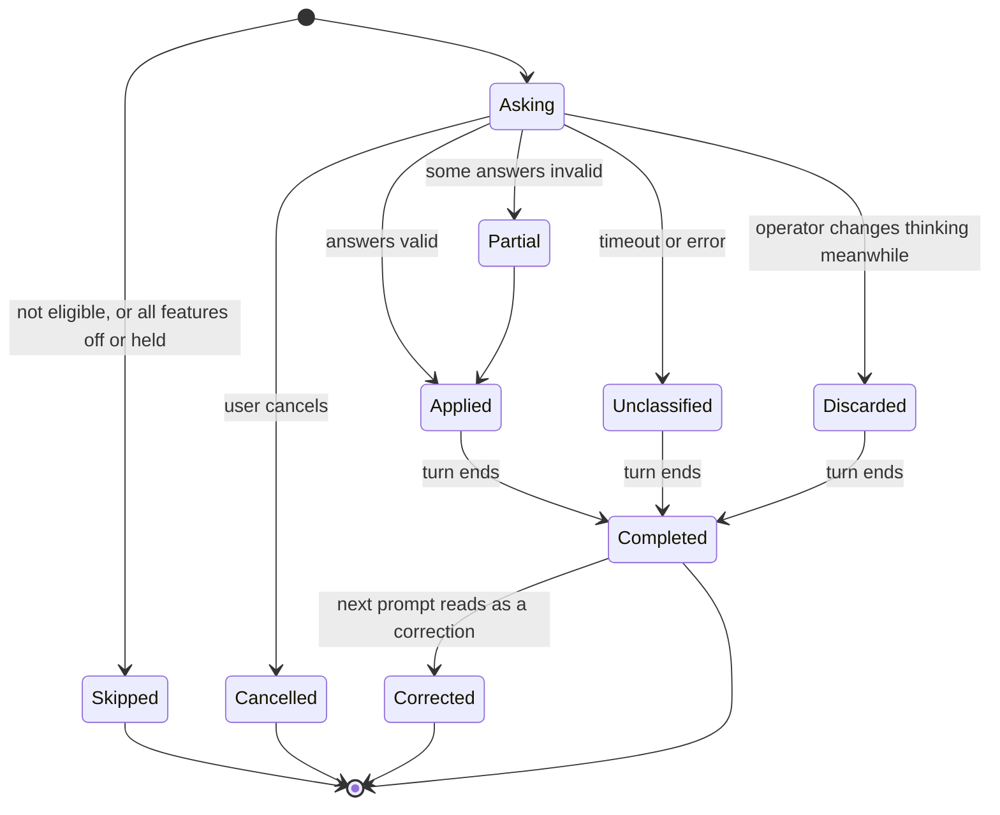
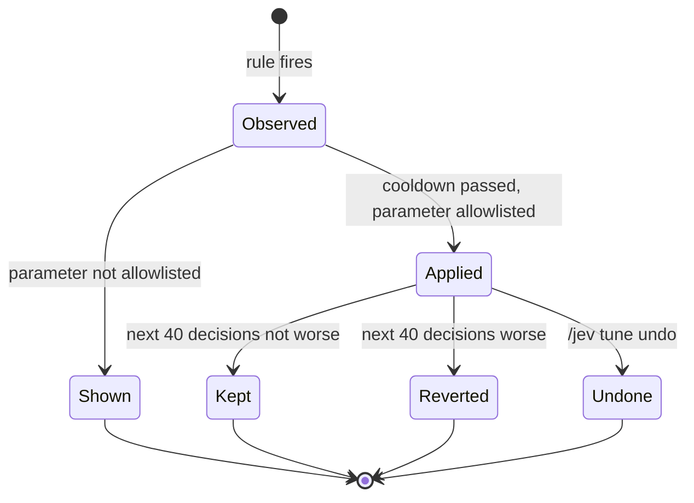

# Domain model

The concepts the system reasons about, the rules that hold them together, and where each one lives. Terms are defined in the [glossary](glossary.md).

## Value types

### EffortLevel

`low < medium < high < xhigh < max`. Jev answers on this ladder. Pi's thinking levels also include `off` and `minimal`, which Jev is never asked about.

**Requested** is what the policy wanted. **Effective** is what the model supports after clamping. They are recorded separately.

### Tier

`fast`, `balanced`, `deep`, `expert`. A tier is a role, not a model. Configuration maps each to a physical `provider/id`.

| Tier | Typical model | For |
|---|---|---|
| `fast` | Haiku | Bounded work with nothing to decide |
| `balanced` | Sonnet | Ordinary engineering inside a clear spec |
| `deep` | Opus | Judgment, open specs, unknown causes |
| `expert` | Fable | The hardest work; gated |

All tiers are optional. An unconfigured tier is never offered.

### Mode

`budget`, `standard` (default), `premium`. A mode is a **target table**: the share of tier-routed worker launches for `fast`, `balanced` and `deep`, and a cap for `expert` (see [ADR 0008](decisions/0008-mode-target-cutpoints.md)). Nothing else changes: not the questions, not the worker rubric, not the thresholds for slots or risk, not the main session.

| Mode | `fast` | `balanced` | `deep` | `expert` cap |
|---|---|---|---|---|
| `budget` | 50% | 40% | 10% | 0% |
| `standard` | 20% | 53% | 25% | ≤ 2% |
| `premium` | 0% | 50% | 45% | ≤ 5% |

Each share is meant to stay within ±10 points over recent tier-routed launches. Expert is a cap, not a quota. The targets never change automatically.

### Slot

A named custom model with a `when` description. It joins the tier question as `slot::<name>` in every mode. A slot is a candidate Jev chooses from the brief, not a role bound to an agent. Review routing is simply a slot named `reviewer`.

Unlike upstream, `fast` stays offered when slots exist. Replay showed no interference. Slots do not depend on a mode.

## Decisions

### MainDecision

Made once per eligible main prompt.

| Part | Source | Rule |
|---|---|---|
| Effort | `effort`, `risky` | Choice; `risky > .7` raises to at least `high`; start capped at `xhigh`; clamped with `clampThinkingLevel`; a current `max` is left alone. No confidence gate, no close-call lean |
| Manual change | | The operator changing the level during an outstanding request discards that result. The next prompt decides again. `/jev effort off` hands the level back |
| Hold | Config | Providers in `holdProviders` keep the level of the newest decision (anchored on provider and model) until a compaction or a provider or model switch, without asking `effort` or `risky` |
| Skill | `which`, `gate::*` | At most one; probability ≥ .5, or probability and gate mean both ≥ .3 |
| Advice | `strategy`, `tier` | `direct` attaches nothing; see the strategy gates. Independent of the effort result |
| Correction mark | `corrects` | ≥ .7 writes a `correction` line for the previous turn |

### WorkerDecision

Made once per `subagent` launch, in this order. The first match wins.

1. `expert`: `expert` is offered, the [difficulty score](#difficulty-score-and-cut-points) is at least the expert cut, and effort is `xhigh` or `max`.
2. `risky > .7`: `deep`, or the highest configured tier below `expert`.
3. A slot with probability ≥ .6: that slot. Below .6, continue with the cut.
4. `cut`: the score gives `fast` (at or below the first cut), `balanced` (at or below the second) or `deep`. A tier that is not configured moves to the nearest configured tier below it, else the nearest above it, never `expert`. With no tier configured, nothing is decided.

The ledger reason is `expert`, `risky`, `slot` or `cut`.

Then **effort**: the choice, raised to `high` on risk, capped at `xhigh`, capped at `medium` on `fast`, clamped to the final model. After a fallback move, effort is `xhigh` on every tier, without the `fast` cap.

Then **availability**: an unusable tier warns, naming the setting, and moves down, never to `expert` (the warning is shown once per tier and model per session, and `/jev` clears it); an unusable slot moves to `balanced`, then `fast`, never up; if nothing can run, the input stays unchanged. Pi does not re-validate mutated input, so the target is checked against `ctx.modelRegistry` and its credentials before writing. Errors while a child runs are not retried, because a relaunch may repeat changes.

A launch with `resume` is always left untouched. A forked launch (`inherit_context`) follows `subagents.forkedLaunch`: with `untouched`, the default, it is left alone; with `thinking`, the model is kept and only thinking is changed. An agent file with `locked` always wins and is never fought: when it locks the model, Jev is still asked, only thinking is written, and the tier is recorded (ledger `locked`); when both fields are locked, the launch is untouched. When nothing can run, the input stays unchanged and a warning is shown. An unconfigured tier is never offered, and with no tier or slot configured, no tier question is asked and the worker keeps its model.

### Difficulty score and cut points

`score = Σ rank(t) · P̂(t) + effortRank / 8`, rounded to 3 decimals. Tier ranks are `fast` 0, `balanced` 1, `deep` 2, `expert` 3. `P̂` is the worker `tier` probabilities restricted to tier keys and renormalised, so slots and unconfigured tiers do not shift the scale. Effort ranks are `low` 0 to `max` 4; an unanswered effort counts as `high`. The range is 0–3.5.

Cut points come from a window of the latest 200 eligible `worker` ledger lines: rubric version 2, with a `score`, with `expertOffered`, and with reason `expert`, `risky` or `cut`. The window is pooled across modes, loaded from the ledger at session start and grown in memory as this session writes lines. It is recomputed before each batch of sibling launches, using each launch's mode.

Each window entry's effort is the most likely level of its `effortP`; ties go to the higher level, and `high` when there is no `effortP`.

- `fastMax` and `balancedMax` sit at the score where the cumulative target share ends (rounded half up in integers); equal scores go to the lower tier.
- `expertMin` is the lowest score above `balancedMax` where entries at or above it with effort `xhigh` or `max` stay within the expert cap. It is infinite when the cap is 0.
- With fewer than 100 eligible lines, the **seed** applies. It comes from the 2026-11-07 replay:

| Mode | `fastMax` | `balancedMax` | `expertMin` |
|---|---|---|---|
| `budget` | 1.42 | 2.135 | none |
| `standard` | 1.165 | 1.81 | 2.345 |
| `premium` | none | 1.42 | 2.125 |

Jev's `expert` answer is not asked for any more. An admitted `expert` stands even on high risk, since it is not a cheaper choice.

This is not tuning under [ADR 0005](decisions/0005-bounded-auto-tuning.md): the targets never change automatically and nothing is stored.

Strategy gates compare probabilities, where upstream compared `confidence`. That makes them slightly easier to clear, which is acceptable for advice.

### ToolAssessment

Runs once per worker, at its first `before_agent_start`, and only for agents that declare no `tools` (an empty `tools: []` counts as declared). A score ≥ .5 flags the tool. In `observe` mode (default) nothing is removed. In `enforce` mode flagged tools are removed from `selectedTools` on every turn of that worker, including resumed runs, with no new request. `ask_parent` and `notify_parent` are never candidates, and at most 32 candidates are scored. Assessment can only remove.

The mode is read once, at that first call; a first call that failed or was skipped is not retried. Any failure keeps every tool and records nothing. The counts go on the launch's `worker` ledger line only when that line exists; a resumed launch's line carries none. Counts for a launch that gets no line are kept in a process-wide map of at most 256 entries and dropped oldest first.

## Invariants

These hold everywhere and each has tests.

1. A classifier failure never blocks or delays work beyond the timeout.
2. A cancelled turn starts nothing.
3. The main model is never changed.
4. `max` is never chosen as a starting level, and is never lowered once the operator has set it.
5. `expert` is never a fallback target.
6. A worker's model is written as an exact, validated `provider/id`.
7. The ledger never contains prompt text, briefs, tool arguments or output.
8. The API key is never written to disk or logs.
9. `config.json` is never written by automatic behavior.
10. Automatic tuning touches only allowlisted parameters, one step at a time, inside a fixed range, and every change is visible and undoable.
11. Risk floor, effort ceiling, expert rules and the tool threshold are never tuned automatically.
12. `confidence` never gates a decision.

## Lifecycles

### A main decision

### A tuning change

## Ledger entry

One line per decision in `ledger.jsonl`, at least the latest 2000 kept, in two files (`ledger.jsonl` and `ledger.1.jsonl`), owner-only permissions, safe with several Pi processes. **Never prompt text, briefs, tool arguments or output.**

| Group | Field | Meaning |
|---|---|---|
| Common | `v` | Schema version, always `1` |
| | `at` | Time, milliseconds since the epoch |
| | `kind` | `main`, `worker` or `correction` |
| | `session` | Pi session id |
| | `mode` | Active mode |
| | `answered`, `ms` | Whether Jev answered, and how fast |
| | `miss` | `timeout`, `error` or `schema` |
| Main, worker | `effortP` | All effort probabilities |
| | `risky` | Probability |
| | `requested`, `effective`, `from` | Effort wanted, effort applied, effort before |
| | `held` | Held turn: level left as is, with `effective`, and no `effortP`, `risky` or `requested` |
| | `strategy`, `strategyP`, `advised` | Answer, its probability, whether advice was attached |
| | `skill`, `skillP`, `gate` | Pick, its probability, gate mean |
| | `turnId` | Id of this turn, so a later `correction` line can point at it |
| | `corrects` | This prompt's read of whether it corrects the previous turn |
| | `toolCalls`, `failures`, `outcome`, `durationMs`, `inputTokens`, `outputTokens` | Filled at turn end. `outcome` is `ok`, `error` or `aborted` |
| Worker | `agent`, `briefChars` | Agent name and brief length |
| | `tierP`, `risky` | All raw answers, with `effortP`. Lines from before ADR 0008 may also hold `expertNeeded` |
| | `score`, `rubric`, `expertOffered` | Difficulty score, rubric version and whether `expert` was offered; they make the line eligible for the cut-point window |
| | `tier`, `model`, `effort` | The decision. `tier` is a slot name when a slot won |
| | `reason` | Which rule decided the model: `expert`, `risky`, `slot`, `cut`, `untouched` or `miss`; older lines may hold `expert-admitted`, `expert-denied`, `fast-unsure` or `choice`. All but the last two require `tier`. `untouched` means the model was kept, even if thinking changed |
| | `fallback` | Target that could not run, if any |
| | `callerModel`, `locked` | What the caller asked for; whether the agent file blocked the change |
| | `toolsScored`, `toolsFlagged` | Tool assessment counts; only when the worker got an answer, never on a resumed launch's line |
| | `status`, `durationMs`, `tokens`, `toolUses` | Filled on completion. `status` is `completed`, `aborted`, `stopped` or `error` |
| Correction | `turnId`, `corrects` | The turn being marked, and the probability that marked it (≥ .7) |

Rules:

- Probabilities are stored whole, so later analysis can replay any threshold without calling Jev again.
- Correction: when `corrects ≥ .7`, append a `correction` line carrying the previous turn's `turnId` on the current branch. Lines are never rewritten.
- A line with `miss` has `answered` false.
- Tier and agent must always be recorded. The port's ledger omits tier and writes `agent: unknown`, which is why its tier decisions could only be inferred.

## Tuning

Stored in `tuning.json`, never in `config.json`.

| Rule | Value |
|---|---|
| When checked | `agent_settled`, never during a turn |
| Per change | One parameter, one step |
| Cooldown | At least 40 decisions between changes |
| Revert | Automatic, if the 40 decisions after a change are worse than the 40 before, by the signal that caused it |
| Display | One line on every change, such as `Jev tune: timeoutMs 1500→1800 · /jev tune undo` |
| Never tuned automatically | Risk floor, effort ceiling, expert rules, tool threshold |

**Phase 1 automatically changes `timeoutMs` only:**

- Fires when more than 10% of at least 20 asked requests timed out (`miss: timeout`; errors and schema misses do not count).
- New value: `max(current + 200, p90 × 1.25 rounded up to 100)`.
- Range 300–5000.
- **Blind spot:** tool assessment requests also use `timeoutMs`, but a tool assessment miss writes no ledger line, so the rule cannot see it. Phase 1 accepts this; the ledger schema is unchanged.
- **Skipped** when the config is invalid (the untuned value would then be the code default, not yours), when `tuning.json` or the ledger is unreadable, and in child sessions.
- **Block:** after a revert or an undo, the same raise is held back for 200 decisions. A raise to the blocked value or above is lowered to `blocked − 100`.
- **Base value:** a tuned value records the `base` it was tuned from. It applies only while the config value (or the default) equals that base. If you edit `timeoutMs` in config, the tuned value, the pending change and the block are dropped, and that counts as a change for the cooldown.

**Signals observed and shown by `/jev tune`, per mode, not applied.** Each is a count over the latest 200 decisions of that mode (modes are never mixed), shown as `count/of`:

- `lowWorkerErrors`: `low` or `fast` workers failing, of worker decisions.
- `corrected`: main turns with a correction line, of main decisions.
- `largeAtLow`: large turns at low effort (at least 15 tool calls), of main decisions at low effort.
- `highSmall`: `high` starts finishing in at most two tool calls, without failures, of main decisions at `high`.

A mode with no decisions is left out.

**Seen marker:** `seenAt` in `tuning.json` is the time of the latest history entry already shown. Changes after it are unseen. It is written before the line is shown, so a refused write shows nothing. A change line shown at settle marks itself seen.

**After about 200 decisions,** decide per signal whether it earns automatic adjustment. Increases in spending may apply automatically; decreases need two consecutive windows or a question at idle. If no signal is clear, drop threshold tuning and keep `timeoutMs`. Bars are not lowered merely to make rules fire.
