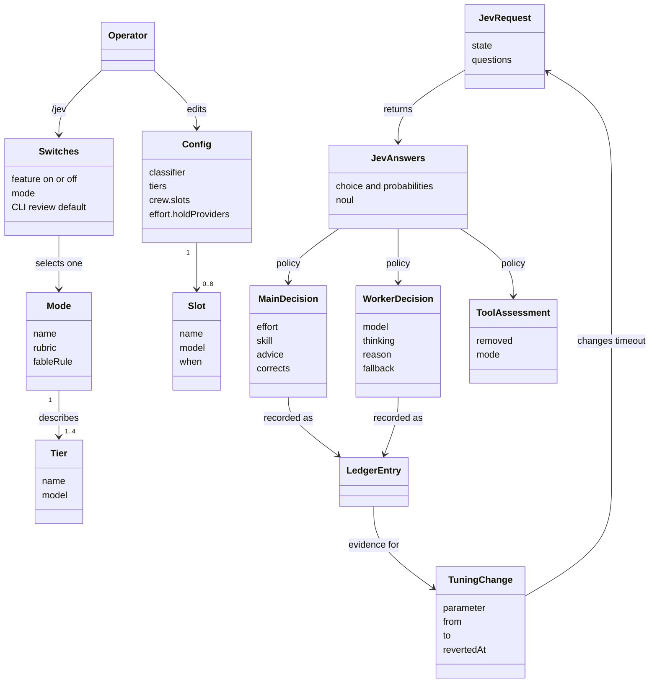
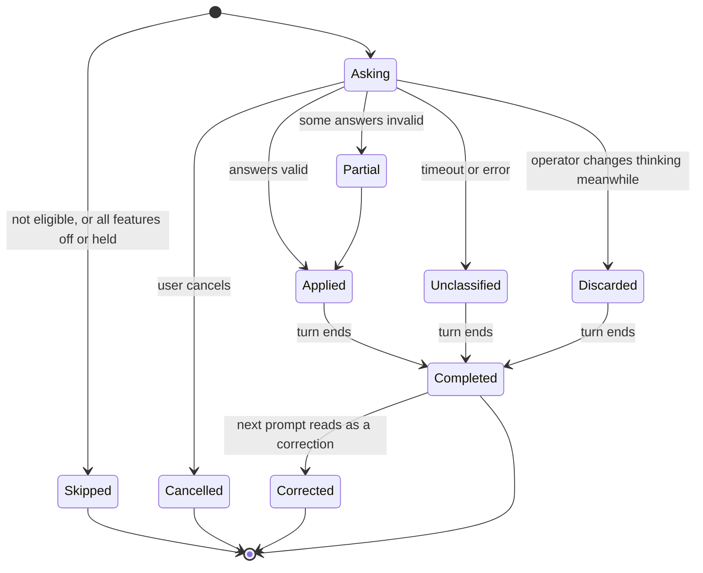
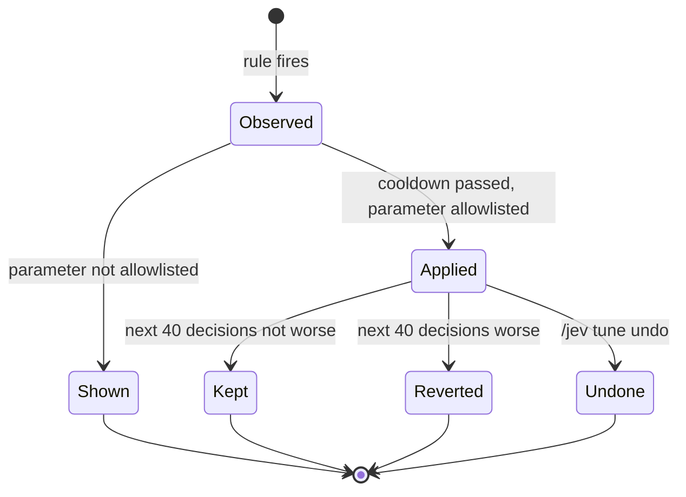

# Domain model

The concepts the system reasons about, the rules that hold them together, and where each one lives. Terms are defined in the [glossary](glossary.md).

## Value types

### EffortLevel

`low < medium < high < xhigh < max`. Jev answers on this ladder. Pi's thinking levels also include `off` and `minimal`, which Jev is never asked about.

**Requested** is what the policy wanted. **Effective** is what the model supports after clamping. They are recorded separately.

### Tier

`fast`, `balanced`, `deep`, `expert`. A tier is a role, not a model. Configuration maps each to a physical `provider/id`.

| Tier | Typical model | For |
|---|---|---|
| `fast` | Haiku | Bounded work with nothing to decide |
| `balanced` | Sonnet | Ordinary engineering inside a clear spec |
| `deep` | Opus | Judgment, open specs, unknown causes |
| `expert` | Fable | The hardest work; gated |

All tiers are optional. An unconfigured tier is never offered.

### Mode

`budget`, `standard` (default), `premium`. A mode selects **one rubric and one Fable rule**. Nothing else changes: not the questions, not the thresholds for slots or `fast`, not the main session.

### Slot

A named custom model with a `when` description. It joins the tier question as `slot::<name>` in every mode. A slot is a candidate Jev chooses from the brief, not a role bound to an agent. Review routing is simply a slot named `reviewer`.

Unlike upstream, `fast` stays offered when slots exist. Replay showed no interference. Slots do not depend on a mode.

## Decisions

### MainDecision

Made once per eligible main prompt.

| Part | Source | Rule |
|---|---|---|
| Effort | `effort`, `risky` | Choice; `risky > .7` raises to at least `high`; start capped at `xhigh`; clamped with `clampThinkingLevel`; a current `max` is left alone. No confidence gate, no close-call lean |
| Manual change | | The operator changing the level during an outstanding request discards that result. The next prompt decides again. `/jev effort off` hands the level back |
| Hold | Config | Providers in `holdProviders` keep the first decision until a compaction, without asking `effort` or `risky` |
| Skill | `which`, `gate::*` | At most one; probability ≥ .5, or probability and gate mean both ≥ .3 |
| Advice | `strategy`, `tier` | `direct` attaches nothing; see the strategy gates |
| Correction mark | `corrects` | ≥ .7 writes a `correction` line for the previous turn |

### WorkerDecision

Made once per `subagent` launch, in this order. The first match wins.

1. The mode's Fable rule passes: `expert`.
2. `risky > .7`: `deep`, or the highest configured tier below `expert`.
3. A slot with probability ≥ .6: that slot. Below .6, continue with the highest tier.
4. `expert` that did not pass the rule: `deep`, or the highest configured tier below `expert`. With no tier below `expert`, nothing is decided.
5. `fast`: only with probability ≥ .6, otherwise `balanced`, or the lowest configured tier above `fast` and below `expert`.
6. Otherwise the chosen tier.

Then **effort**: the choice, raised to `high` on risk, capped at `xhigh`, capped at `medium` on `fast`, clamped to the final model. After a fallback move, effort is `xhigh` on every tier, without the `fast` cap.

Then **availability**: an unusable tier warns, naming the setting, and moves down, never to `expert`; an unusable slot moves to `balanced`; if nothing can run, the input stays unchanged. Pi does not re-validate mutated input, so the target is checked against `ctx.modelRegistry` and its credentials before writing. Errors while a child runs are not retried, because a relaunch may repeat changes.

A launch with `resume` is always left untouched. A forked launch (`inherit_context`) follows `subagents.forkedLaunch`: with `untouched`, the default, it is left alone; with `thinking`, the model is kept and only thinking is changed. When the agent file locks the model, Jev is still asked, only thinking is written, and the tier is recorded. When both fields are locked, the launch is untouched. When nothing can run, the input stays unchanged and a warning is shown. An agent file with `locked` wins: the executor ignores the change and reports it, and this is logged, not fought. An unconfigured tier is never offered, and with no tier or slot configured, no tier question is asked and the worker keeps its model.

### Fable rules

| Mode | Rule |
|---|---|
| `budget`, `standard` | `tier` is `expert` and `expert_needed > .9` |
| `premium` | `tier` is `deep` or `expert`, `P(expert) ≥ .1`, and `effort` is `xhigh` or `max` |

These read Jev's raw answers (`tier.choice`, `effort.choice`), before any cap or clamp. An admitted `expert` stands even on high risk, since it is not a cheaper choice.

Strategy gates compare probabilities, where upstream compared `confidence`. That makes them slightly easier to clear, which is acceptable for advice.

### ToolAssessment

Only for agents that declare no `tools`. A score ≥ .5 means removal. In `observe` mode nothing is removed, only recorded. `ask_parent` and `notify_parent` are never candidates. Assessment can only remove.

## Invariants

These hold everywhere and each has tests.

1. A classifier failure never blocks or delays work beyond the timeout.
2. A cancelled turn starts nothing.
3. The main model is never changed.
4. `max` is never chosen as a starting level, and is never lowered once the operator has set it.
5. `expert` is never a fallback target.
6. A worker's model is written as an exact, validated `provider/id`.
7. The ledger never contains prompt text, briefs, tool arguments or output.
8. The API key is never written to disk or logs.
9. `config.json` is never written by automatic behavior.
10. Automatic tuning touches only allowlisted parameters, one step at a time, inside a fixed range, and every change is visible and undoable.
11. Risk floor, effort ceiling, expert rules and the tool threshold are never tuned automatically.
12. `confidence` never gates a decision.

## Lifecycles

### A main decision

### A tuning change

## Ledger entry

One line per decision in `ledger.jsonl`, at least the latest 2000 kept, in two files (`ledger.jsonl` and `ledger.1.jsonl`), owner-only permissions, safe with several Pi processes. **Never prompt text, briefs, tool arguments or output.**

| Group | Field | Meaning |
|---|---|---|
| Common | `v` | Schema version, always `1` |
| | `at` | Time, milliseconds since the epoch |
| | `kind` | `main`, `worker` or `correction` |
| | `session` | Pi session id |
| | `mode` | Active mode |
| | `answered`, `ms` | Whether Jev answered, and how fast |
| | `miss` | `timeout`, `error` or `schema` |
| Main, worker | `effortP` | All effort probabilities |
| | `risky` | Probability |
| | `requested`, `effective`, `from` | Effort wanted, effort applied, effort before |
| | `held` | Decided by hold, without asking |
| | `strategy`, `strategyP`, `advised` | Answer, its probability, whether advice was attached |
| | `skill`, `skillP`, `gate` | Pick, its probability, gate mean |
| | `turnId` | Id of this turn, so a later `correction` line can point at it |
| | `corrects` | This prompt's read of whether it corrects the previous turn |
| | `toolCalls`, `failures`, `outcome`, `durationMs`, `inputTokens`, `outputTokens` | Filled at turn end. `outcome` is `ok`, `error` or `aborted` |
| Worker | `agent`, `briefChars` | Agent name and brief length |
| | `tierP`, `expertNeeded`, `risky` | All raw answers, with `effortP` |
| | `tier`, `model`, `effort` | The decision. `tier` is a slot name when a slot won |
| | `reason` | Which rule decided the model: `fable`, `risky`, `slot`, `expert-denied`, `fast-unsure`, `choice`, `untouched` or `miss`. All but the last two require `tier`. `untouched` means the model was kept, even if thinking changed |
| | `fallback` | Target that could not run, if any |
| | `callerModel`, `locked` | What the caller asked for; whether the agent file blocked the change |
| | `toolsScored`, `toolsFlagged` | Tool assessment counts |
| | `status`, `durationMs`, `tokens`, `toolUses` | Filled on completion. `status` is `completed`, `aborted`, `stopped` or `error` |
| Correction | `turnId`, `corrects` | The turn being marked, and the probability that marked it (≥ .7) |

Rules:

- Probabilities are stored whole, so later analysis can replay any threshold without calling Jev again.
- Correction: when `corrects ≥ .7`, append a `correction` line carrying the previous turn's `turnId` on the current branch. Lines are never rewritten.
- A line with `miss` has `answered` false.
- Tier and agent must always be recorded. The port's ledger omits tier and writes `agent: unknown`, which is why its tier decisions could only be inferred.

## Tuning

Stored in `tuning.json`, never in `config.json`.

| Rule | Value |
|---|---|
| When checked | `agent_settled`, never during a turn |
| Per change | One parameter, one step |
| Cooldown | At least 40 decisions between changes |
| Revert | Automatic, if the 40 decisions after a change are worse than the 40 before, by the signal that caused it |
| Display | One line on every change, such as `Jev tune: timeoutMs 1500→1800 · /jev tune undo` |
| Never tuned automatically | Risk floor, effort ceiling, expert rules, tool threshold |

**Phase 1 automatically changes `timeoutMs` only:**

- Fires when more than 10% of at least 20 asked requests went unanswered.
- New value: `max(current + 200, p90 × 1.25 rounded up to 100)`.
- Range 300–5000.

**Signals observed and shown by `/jev tune`, per mode, not applied:**

- `low` or `fast` workers failing.
- Main turns with a correction line.
- Large turns at low effort (at least 15 tool calls).
- `high` starts finishing in at most two tool calls, without failures.

**After about 200 decisions,** decide per signal whether it earns automatic adjustment. Increases in spending may apply automatically; decreases need two consecutive windows or a question at idle. If no signal is clear, drop threshold tuning and keep `timeoutMs`. Bars are not lowered merely to make rules fire.
