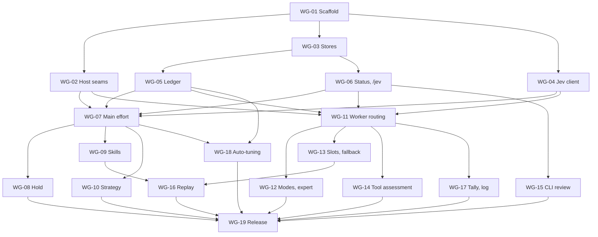

# Roadmap

The work is split into small groups, each one independently reviewable and each leaving the package working. Build them in order; the graph shows what can run in parallel.

Sizes: **S** is about one task, **M** a few, **L** many. They compare work groups and are not time estimates.

## Status

| Group | Title | Size | Depends on | Status |
|---|---|---|---|---|
| WG-01 | Repository scaffold | S | | Done |
| WG-02 | Host seam verification | M | WG-01 | Done |
| WG-03 | Config and state stores | M | WG-01 | Done |
| WG-04 | Jev client and answer reading | M | WG-01 | Done |
| WG-05 | Ledger | M | WG-03 | Done |
| WG-06 | Status line and `/jev` base | M | WG-03 | Done |
| WG-07 | Main effort | M | WG-02, 04, 05, 06 | Done |
| WG-08 | Effort hold | S | WG-07 | Done |
| WG-09 | Skill pick and delivery | L | WG-07 | Done |
| WG-10 | Strategy advice | S | WG-07 | Done |
| WG-11 | Worker routing core | L | WG-02, 04, 05, 06 | Done |
| WG-12 | Modes and expert tier | M | WG-11 | Done |
| WG-13 | Slots and fallback | M | WG-11 | Done |
| WG-14 | Tool assessment, observe only | M | WG-11 | Done |
| WG-15 | CLI review | M | WG-06 | Done |
| WG-16 | Rich state replay | M | WG-09, 13 | Done |
| WG-17 | Tally and log | S | WG-11 | Done |
| WG-18 | Auto-tuning | M | WG-05, 07 | Done |
| WG-19 | Release and migration guide | S | All above | Planned |

## Milestones

| Milestone | Complete after | What you can do |
|---|---|---|
| **M0: Foundations** | WG-01 to 06 | Load the package; `/jev` works; nothing decides yet. Host assumptions are known |
| **M1: Main session** | WG-07 to 10 | Effort, skills and advice work on the main session |
| **M2: Workers** | WG-11 to 13 | Workers route by mode, with the reviewer slot |
| **M3: Complete** | WG-14 to 18 | Every selected feature exists, with calibrated state |
| **M4: 0.1 release** | WG-19 | Others can install it |

Each milestone is a natural point to install the package for real use, once the operator approves that exact commit. Until then, testing stays in an isolated `PI_CODING_AGENT_DIR`.

## Work groups

### WG-01: Repository scaffold

Set up an empty package that Pi can load.

- **Includes:** `package.json` with the `pi` manifest, TypeScript, tests, lint and format, MIT `LICENSE`, CI, lint rules for the [dependency boundaries](architecture.md#dependency-rules).
- **Done when:** `pi install` of the checkout loads an extension that does nothing, and CI passes.

### WG-02: Host seam verification

Replace assumptions with evidence before building on them. **This group may change later groups.**

- **Includes:** a throwaway extension and a report in `docs/evidence/` answering:
  1. Do `input.model` and `input.thinking` mutations reach the child, for foreground and background launches?
  2. Does `message_end` finish before `tool_call` preflight?
  3. Can a child's `before_agent_start` remove tools through `selectedTools`, and does the model then lack them?
  4. Is `subagents:child:session-created` visible to the extension, in time, with a usable session id?
  5. Is a hidden `before_agent_start` message sent to the model and kept across compaction as expected?
  6. Does `setThinkingLevel` in `before_agent_start` apply to that same turn's first request?
  7. Does a mutated `model` still behave with `inherit_context`, or should it be skipped?
  8. How do `thinking_level_change` and the prompt cache behave on `claude-code` in a controlled run?
- **Done when:** each question has an answer from a real run, and these documents are updated where an answer contradicts them.

### WG-03: Config and state stores

- **Includes:** schema and validation of `config.json`; `state.json`; path handling through `PI_CODING_AGENT_DIR`; atomic writes.
- **Done when:** malformed input reports the field and leaves the package inert; a key found in config is rejected; nothing rewrites `config.json` except `/jev` slot commands.
- **Note:** the CLI review override from `/jev cli-review` lives in `state.json`, not `config.json`.
- **Note:** The `classifier.url` rule is the Jev client's rule, shared through `src/shared/urls.ts`.

### WG-04: Jev client and answer reading

- **Includes:** `jev/client.ts` (timeout, abort, no redirects, URL rules, no retry) and `policy/answers.ts` (per-question validation).
- **Done when:** tests against a local fixture cover success, timeout, 4xx and 5xx, redirect, malformed JSON, one bad answer among good ones, and cancellation.

### WG-05: Ledger

- **Includes:** the schema with no free-text fields, append, keep at least the latest 2000 in two rotating files, tolerance of bad lines, safe writes from several processes, owner-only permissions.
- **Done when:** concurrent writers lose no line in a test, and a test proves a long text field is rejected.

### WG-06: Status line and `/jev` base

- **Includes:** widget, `/jev` status, feature switches, `reset`, usage text; child registry; key and executor presence checks.
- **Done when:** the real CLI shows the status, switches persist across a restart, and print and JSON modes draw nothing.

### WG-07: Main effort

**A1.** The first real decision, and the first end-to-end test.

- **Includes:** `before_agent_start`, eligibility, E2 state in its minimal form, `effort` and `risky`, policy (floor, ceiling, clamp, `max` kept), discarded result on a manual change, ledger lines including turn outcome and `corrects`.
- **Done when:** the real CLI with a local fixture sets the expected level on the first request, with Jev down nothing changes, and Esc starts nothing.

### WG-08: Effort hold

**A5.** Decision kept on listed providers until a compaction or a model switch; one new decision after a compaction; questions omitted while held.

- **Done when:** a host test shows no thinking change after the first decision on a held provider, and exactly one after a compaction.
- **Note:** in the [WG-02 Q8](evidence/2026-11-05-host-seams.md#q8) run, `claude-code` kept the prompt cache across a thinking change, so it is not in the default hold list.

### WG-09: Skill pick and delivery

**C1, C2, C5.**

- **Ships as two changes:** `wg-09-skill-policy` (criteria, batches, questions, pick, delivery text, duplicate check) and `wg-09-skill-host` (catalog, eligibility, `/skill:name` skip, hidden message, ledger, host test).
- **Includes:** catalog from `getCommands`, batching over 254, gates, pick logic, platform scan, injection and suggestion through a hidden message, no duplicates on a branch, explicit `/skill:name` skips.
- **After a compaction:** a hidden message injected earlier is gone ([WG-02 Q5](evidence/2026-11-05-host-seams.md#q5)), so delivery must not assume a skill or advice injected before a compaction is still present.
- **Done when:** a host test proves the body reaches the provider exactly once across repeated picks, and the `(none)` and gate paths attach nothing.

### WG-10: Strategy advice

**D1.** `tier` and `strategy` questions, gates on probability, block text without `junior`.

- **Done when:** each gate's boundary has a test, and `direct` attaches nothing.

### WG-11: Worker routing core

**B1, B2.** The largest group; it depends most on WG-02. It shipped as two changes, both landed:

- `wg-11-worker-policy`: agent reader, worker request, pure decision, effort and fallback.
- `wg-11-worker-host`: host wiring, `subagents.forkedLaunch`, registry and credential check, pre-launch tier cascade with a warning naming the setting, ledger outcome.

The pre-launch tier cascade moved here from WG-13.

- **Includes:** child registry, agent metadata reader and built-in table, worker state, `standard` rubric, decision order, effort rules with the `fast` cap, batching at `message_end` ([WG-02 Q2](evidence/2026-11-05-host-seams.md#q2)), input mutation with validation, `locked` handling, worker outcome in the ledger.
- **Decision ([WG-02 Q7](evidence/2026-11-05-host-seams.md#q7)):** forked launches follow `subagents.forkedLaunch`, default `untouched`; `thinking` keeps the model and changes only thinking.
- **Also includes:** launches issued by another tool (nested, `parentToolCallId`) are classified at `tool_call`; `resume` and `inherit_context` are read as effective values (launch input, else the agent file); the pre-launch tier cascade uses effort `xhigh` on every tier and warns with the failing tier, the tier used instead and the setting to fix.
- **Done when:** a real child runs on the chosen model and thinking in foreground and background, `resume` is untouched, a forked launch follows `subagents.forkedLaunch`, an unusable tier cascades down, never to `expert`, and a Jev outage leaves launches unchanged.

### WG-12: Modes and expert tier

**Modes, H1.** Rubrics as data, `/jev mode`, expert gates, mode in the ledger. Later replaced by target tables and cut points (#39).

- **Done when:** the [decision order](domain-model.md#workerdecision) has a table test per mode, and a replay of real briefs reproduces the [recorded distribution](evidence/2026-11-05-replay.md#routing-by-mode) within noise. That replay needs approval at the time.
- **Result:** the [2026-11-07 replay](evidence/2026-11-07-replay.md) reproduced `budget` and `premium`. `standard` shifted toward `deep`. The operator accepted this and set target mixes per mode in [#39](https://github.com/ttdua/pi-jev-pilot/issues/39).
- **Follow-up:** [#39](https://github.com/ttdua/pi-jev-pilot/issues/39) is done by the `tune-mode-tier-mix` change: one worker rubric, a difficulty score, cut points recomputed from the ledger and per-mode targets. See [ADR 0008](decisions/0008-mode-target-cutpoints.md), which replaces ADR 0003. The [tier-mix replay](evidence/2026-11-07-tier-mix.md) puts every mode in range over all launches and when a reviewer slot takes the reviews. Non-review launches within a mixed window miss their range by 10–13 points.

### WG-13: Slots and fallback

**F1, H3.**

- **Includes:** config and `/jev <slot>` commands checked against the registry, nearest-name hints, `slot::` options, probability bar, slot fallback to `balanced`, warnings naming the setting.
- **Done when:** the reviewer slot routes in a host test, an unusable slot falls back to `balanced`, and `expert` is never a target of fallback.

### WG-14: Tool assessment, observe only

**H2.** Child handler, tool state from `getAllTools`, scoring, would-remove counts in the ledger, `ask_parent` and `notify_parent` excluded, `enforce` behind a setting. Landed as `wg-14-tool-assessment`; evidence in [host seams](evidence/2026-11-05-host-seams.md#tool-assessment-service-lookup-wg-14).

- **Done when:** in `observe` a worker's tools are unchanged and counts are recorded; in `enforce` a host test proves a removed tool is unavailable; a Jev failure keeps all tools.

### WG-15: CLI review

**F4.** `jev_review` with per-call `reviewer`, `model` and `effort`; Codex and OpenCode command lines; `/jev cli-review` with validation against each CLI's model list; Codex tier names resolved at each run; one retry on timeout only; independent of the key and the switches; hidden in children through `before_agent_start`.

- **Done when:** a fake CLI covers success, failure and timeout; a real run with the operator's CLI works (`tests/host/manual/cli-review-real.ts`); the tool is absent in children.

### WG-16: Rich state replay

Decide which [state fields](jev-contract.md#main-state) ship. **Sends real prompts: needs the operator's approval at the time.**

- **Includes:** `scripts/replay`, rebuilt from the [evidence's method](evidence/2026-11-05-replay.md), since the earlier one-off scripts are not in this repository. It reads local sessions, calls Jev, and writes aggregates plus a private table of differing cases outside the repository.
- **Corpus:** about 100 main prompts and about 46 worker briefs, resampled from current sessions.
- **Variants:** full state against minimal state, one field group at a time, a noise rerun, and `effort` with reversed options, since TypeSafe documents a lean toward the first option.
- **Rule:** there is no ground truth, so a metric alone cannot decide. A field group stays only if it changes more decisions than noise and the operator, reading the changed cases, prefers the new answers. Otherwise it is removed. Agent `description` and instructions, and tool metadata, stay unless they clearly harm, since the operator asked for them explicitly. If reversed options shift answers beyond noise, the operator chooses a fixed order.
- **Done when:** each field group is decided under this rule, or dropped by the operator without measurement (`workspace.git`), and results are in `docs/evidence/`.

### WG-17: Tally and log

**G4, G7.** Session counts, status line every 10th prompt, optional log lines, verbose raw answers.

- **Done when:** log lines are absent from provider requests in a host test.

### WG-18: Auto-tuning

**Status:** Done. Policy in `wg-18-tuning-policy`, host in `wg-18-tuning-host`.

**G3, phase 1.** `agent_settled` check, `timeoutMs` rule, cooldown, automatic revert, `/jev tune` and its subcommands, signals shown per mode.

- **Split:** `wg-18-tuning-policy` holds the rules and `tuning.json`. The host change holds `agent_settled`, `/jev tune`, the change line and the signals.
- **Done when:** tests cover fire, cooldown, range, revert and undo; nothing outside the allowlist can change, and `config.json` is untouched.

### WG-19: Release and migration guide

- **Includes:** README final, `CHANGELOG.md`, migration steps from the port, package acceptance test from a packed tarball.
- **Done when:** a clean `PI_CODING_AGENT_DIR` installs from the tarball and passes acceptance. **Publishing needs the operator's explicit go-ahead.**

## After 0.1

Not committed. Each needs evidence or a decision first.

| Item | Why | Needs |
|---|---|---|
| Effort rubric revision | `high` is about 57% of worker decisions | Replay with a rewritten rubric |
| Quality check of `budget` | Unknown whether Haiku does this work well | Ledger comparison after real use, or a fixture benchmark |
| Quality check of the reviewer slot | Routing is proven, review quality is not | Real findings compared |
| Decision on threshold tuning | Upstream's rules never fired on real data | About 200 decisions per signal, then keep or drop |
| `enforce` by default for tool assessment | Unknown whether removals are right | Would-remove counts reviewed |
| Calibrating the expert cut | Two cases in replay | More data |
| More work reaching the fast tier | Only 7 of 532 launches were `scout` | Decide whether to encourage delegation |
| OpenRouter or Vercel backends | Excluded for now | Demand |

## Working agreements

- Stop and ask before adding a dependency, changing a public command or file format, or any decision whose cost, if wrong, exceeds one work group.
- Nothing is pushed, merged or published without the operator's explicit go-ahead.
- If WG-02 contradicts these documents, update them and this roadmap before continuing.
- Routing and effort are on by default from their first release, since rubrics, slots and modes are already measured. Rich state fields were decided by WG-16; see the replay evidence.
