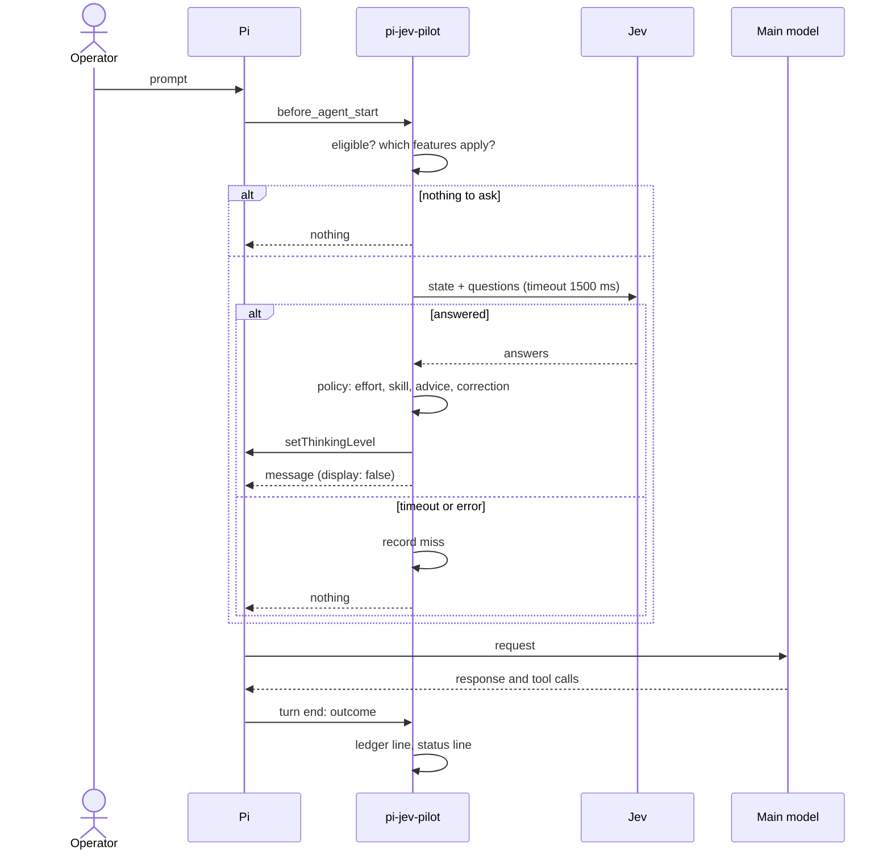
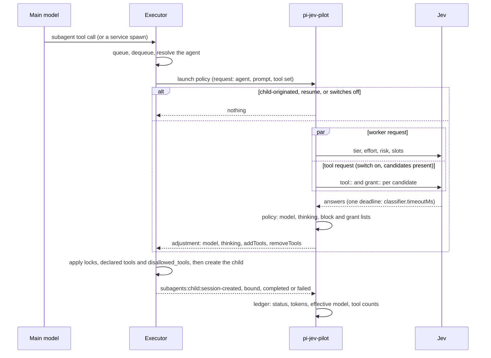
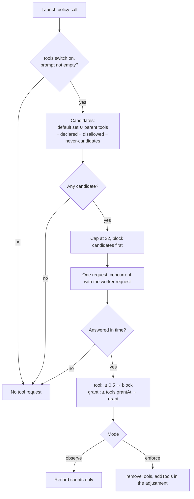
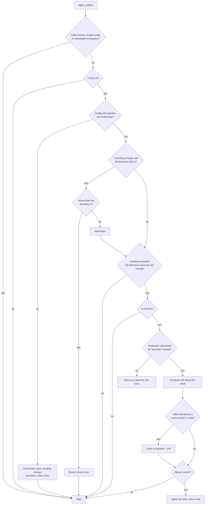
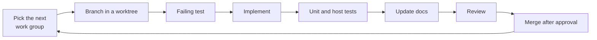

# Workflows

What happens at each moment, step by step. For the rules applied, see the [domain model](domain-model.md). For the exact requests, see the [Jev contract](jev-contract.md).

## 1. A main prompt

**Skipped when** the run was started by a custom message, the prompt is empty, the session is a child, or every applicable feature is off. Skills apply only with a catalog and no explicit `/skill:name`.

**While held** (provider in `effort.holdProviders`, and the newest decision after the latest compaction was made on the same provider and model), `effort` and `risky` are not asked. Only `corrects` is asked. The thinking level is never touched, and the status line shows the level in force, also when Jev misses.

**If the operator changes the thinking level while waiting**, that result is discarded. The next prompt decides again. With a catalog over 254 skills the effort level is applied only once every batch has answered (still within one timeout), so a manual level change during that wait also discards the effort result.

**If the operator presses Esc before the first provider request**, Pi aborts the run. When the run settles aborted with no provider request, the package puts back the level it replaced, only if the current level is still the one it set, and the status line returns to its previous text. No ledger line is written. Esc after a provider request started is a normal turn with `outcome: aborted`.

**Ledger and status:** one `main` line per decided turn, written when the turn settles, and a `correction` line for the previous turn when `corrects` is at least .7. A `jev-turn` entry holding the turn id is added to the session so the next correction finds it. When the turn produced an effective level without being held and without a compaction, the entry also carries `decided` (provider, model, level); that is the anchor of the hold. The status line shows the decided level (`Jev · standard · high`) or `Jev · no answer`.

**Effect on the session:**

- A `thinking_level_change` entry when the level changes, and the footer shows the new level.
- A hidden custom message when a skill or advice applies. It stays in history until compaction.
- A skill picked again while its body is still in context is sent as a one-line reference.
- About 0.5 s of waiting per prompt.

## 2. A worker launch

The executor calls the launch policy once per new launch, from either door, after dequeue and before the child is created. The policy is registered by the main session at `session_start`. It does not run for `resume`, which creates no session.

What the policy leaves alone:

- A launch whose parent is a child session.
- A service `spawn()` that names a model: the model is kept and thinking is still decided, as for an agent file that locks only the model.
- A forked launch (`inherit_context`) under the default `subagents.forkedLaunch`; with `thinking` only thinking changes.
- Anything the agent file locks. The executor enforces this; a locked field is never changed.

If the policy throws, is too slow or returns something malformed, the launch runs unchanged. The ledger joins events to launches by `agentId`; a resumed launch writes no line.

**Model selection example** with the default `standard` mode. The tier follows the difficulty score and the mode's cut points; the table shows only typical reads:

| Brief reads as | Jev answers | Result |
|---|---|---|
| Fix three named wording issues, check named | `fast` .86 (low score) | Haiku, effort capped at `medium` |
| Same, but less certain | `fast` .52 (score near the cut) | Haiku or Sonnet, by the cut |
| Implement a feature to a written spec | `balanced` .95 | Sonnet |
| Task spanning many crates | `deep` .66 | Opus |
| Review a pull request | `slot::reviewer` .92 | The `reviewer` slot's model |
| Anything that would deploy or delete data | `risky` .9 | Opus, effort at least `high` |

**Effect on the session:** worker model and effort differ from what the main model asked for, and the ledger records `callerModel`, plus `effectiveModel` and `effectiveThinking` as the executor applied them. The executor's widget shows the actual model.

## 3. Tool assessment at launch

Runs inside the launch policy call (workflow 2), in the main session, for every agent. The child is not involved.

- **Declared `tools` are kept** and `disallowed_tools` are never added. Only the rest is decided.
- **Block candidates** are tools the child would have by default. They get `tool::<name>`.
- **Grant candidates** are tools in the parent session the child would not have. They get `grant::<name>`; the default cut is `tools.grantAt` 0.8.
- **Never candidates:** `jev_review` and the executor's own tools (`subagent`, `get_subagent_result`, `steer_subagent`, `ask_parent`, `notify_parent`).
- **Cost:** one extra Jev request per launch with candidates, concurrent with the worker request, under one `classifier.timeoutMs` deadline. A failure keeps the default tools and records nothing.
- **Checked grants.** The executor drops grants outside the parent's tools. After the child binds, it also drops tools the child did not register and reports the rest as `grantedTools`. The ledger's `toolsGranted` counts those.
- **Child guard.** The child still hides `jev_review` in `before_agent_start`, for an agent that names it in `tools`.
- **Resume.** A resumed worker keeps the tools it started with; no new request.

Default is `observe`: tools are recorded, not changed.

## 4. A mode change

1. `/jev mode budget` (this directory) or `/jev mode budget global` (every directory without its own mode).
2. `<cwd>/.pi/jev-mode.json` or `state.json` is updated. No Jev call.
3. The next launch uses the `budget` target table and its cut points, from the same window. The worker request is identical. Running workers are unaffected.
4. Each ledger line records its mode, so tuning signals are never mixed across modes.

## 5. Auto-tuning

Tuning is skipped in child sessions, with an invalid config (the untuned value would be wrong) and when `tuning.json` or the ledger is unreadable. A change line is shown only when a UI exists. Phase 1 allowlists `timeoutMs` only. Tool assessment shares the launch deadline `timeoutMs`, but its misses write no ledger line, so the rule does not see them; phase 1 accepts this blind spot. Everything else stays visible through `/jev tune`. See [ADR 0005](decisions/0005-bounded-auto-tuning.md).

## 6. A CLI review

Only when the operator asks, such as "have Codex review this".

1. The model calls `jev_review` with `brief`, and optionally `reviewer`, `model`, `effort`. The tool description tells it to call only when the user asks. Fields set in the call win over the `/jev cli-review` default for that call only. Naming another reviewer drops the default's model and effort. A new `model` drops the default's effort.
2. The extension runs the CLI through `pi.exec`, with no relaying agent. The prompt is the [review instructions](jev-questions.md#cli-review-instructions) followed by the brief, passed as one argument (no stdin):
   - Codex: `codex exec [-m <model>] [-c model_reasoning_effort="<effort>"] -s read-only --skip-git-repo-check --ephemeral -C <cwd> -o <temp file> <prompt>`. The result is read from the temp file, or from stdout when the file is empty. The file is removed after each run.
   - OpenCode: `opencode run [-m <provider/model>[#<effort>]] --agent plan <prompt>`, run in the session's directory. The result is read from stdout.
3. The tool returns findings and a verdict. On failure, the result says the review did not run, gives the reason (not found, exit code, timeout, cancelled, output over 8 MiB or could not start) and the last lines of the CLI's error output. It does not switch to the other reviewer.
4. Timeout is 10 minutes per attempt, with one retry on timeout only. A failure is not retried. A review cancelled before any CLI starts reports one attempt with outcome `cancelled`.

The review needs no Jev key and ignores the feature switches and `/jev all off`. It needs the CLI review to be on, and runs whenever the operator asks.

Codex tier names (`sol`, `terra`, `luna`) resolve at each run to the newest model of that tier listed by `codex debug models`, so a newer model is picked up without a change here. When the list cannot be read, the stored name is passed to Codex as written. The success text names the model that ran.

This is separate from the `reviewer` slot, which routes ordinary review subagents to a chosen model. See [ADR 0004](decisions/0004-review-as-a-slot.md).

## 7. A compaction

1. `session_compact` fires.
2. A held effort is released because the anchor is now before the compaction, so the next prompt makes one new decision.
3. Skill bodies that the compaction dropped are sent again in full if picked again; bodies it kept are referenced.
4. Nothing else changes. The ledger is unaffected.

## 8. Session start

1. Read `config.json`. If malformed, report and stay inert.
2. Read `state.json` and `tuning.json`.
3. Check the API key's presence, without calling Jev.
4. Capture the executor service and register the launch policy; note an absent executor or a `duplicate` one. Workers still running at a reload or session switch get no ledger line.
5. Draw the status line. In print and JSON modes, nothing is drawn.
6. Show one line if tuning changed something since the last session. `seenAt` is written first, so a refused write shows nothing; without a UI nothing is written or shown.

## Developer workflow

See [Contributing](../CONTRIBUTING.md) and the [roadmap](roadmap.md).

