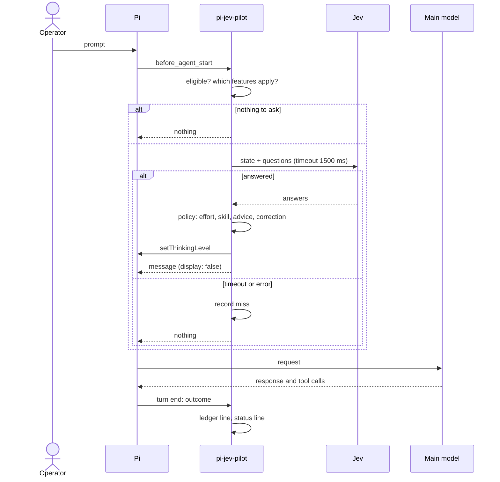
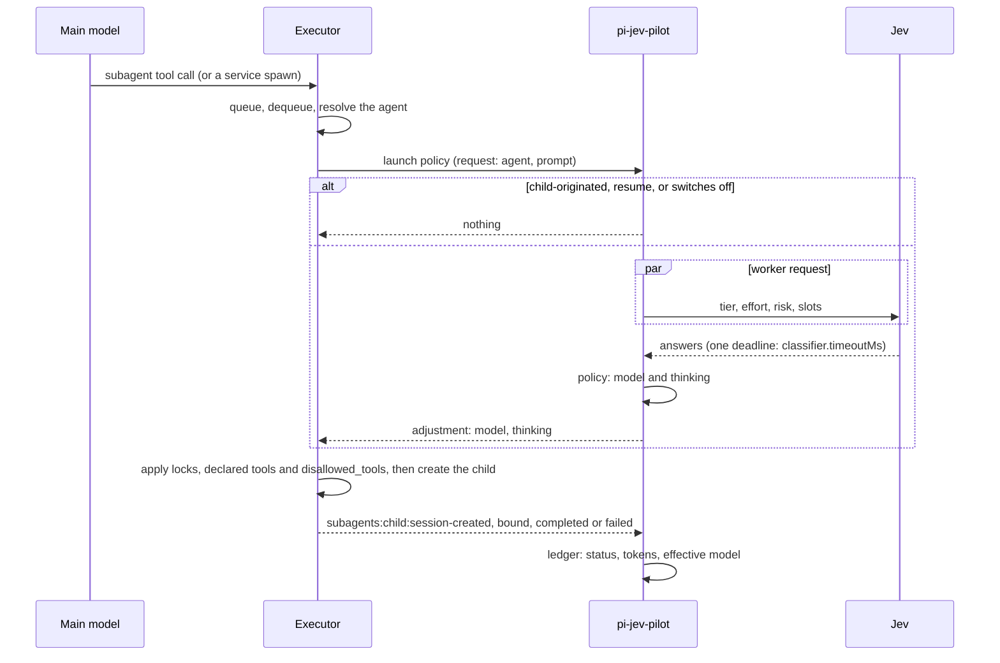
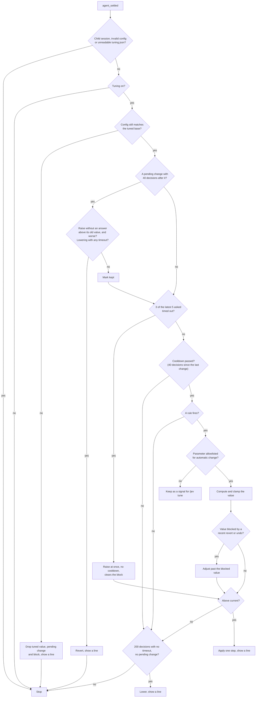
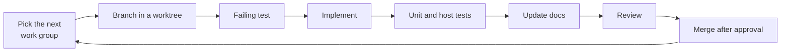

# Workflows

What happens at each moment, step by step. For the rules applied, see the [domain model](domain-model.md). For the exact requests, see the [Jev contract](jev-contract.md).

## 1. A main prompt

**Skipped when** the run was started by a custom message, the prompt is empty, the session is a child, or every applicable feature is off. Skills apply only with a catalog and no explicit `/skill:name`.

**While held** (provider in `effort.holdProviders`, and the newest decision after the latest compaction was made on the same provider and model), `risky` is not asked, and `effort` is asked only for the strategy gate when `strategy` is on. Otherwise only `corrects` is asked. The thinking level is never touched, and the status line shows the level in force, also when Jev misses.

**If the operator changes the thinking level while waiting**, that result is discarded. The next prompt decides again. With a catalog over 254 skills the effort level is applied only once every batch has answered (still within one timeout), so a manual level change during that wait also discards the effort result.

**If the operator presses Esc before the first provider request**, Pi aborts the run. When the run settles aborted with no provider request, the package puts back the level it replaced, only if the current level is still the one it set, and the status line returns to its previous text. No ledger line is written. Esc after a provider request started is a normal turn with `outcome: aborted`.

**Ledger and status:** one `main` line per decided turn, written when the turn settles, and a `correction` line for the previous turn when `corrects` is at least .7. A `jev-turn` entry holding the turn id is added to the session so the next correction finds it. When the turn produced an effective level without being held and without a compaction, the entry also carries `decided` (provider, model, level); that is the anchor of the hold. The status line shows the decided level (`Jev · standard · high`) or `Jev · no answer`.

**Effect on the session:**

- A `thinking_level_change` entry when the level changes, and the footer shows the new level.
- A hidden custom message when a skill or advice applies. It stays in history until compaction.
- A skill picked again while its body is still in context is sent as a one-line reference.
- About 0.5 s of waiting per prompt.

## 2. A worker launch

The executor calls the launch policy once per new launch, from either door, after dequeue and before the child is created. The policy is registered by the main session at `session_start`. It does not run for `resume`, which creates no session.

What the policy leaves alone:

- A launch whose parent is a child session.
- A service `spawn()` that names a model: the model is kept and thinking is still decided, as for an agent file that locks only the model.
- A fork launch (`context: fork`) under the default `subagents.forkLaunch`; with `thinking` only thinking changes.
- Anything the agent file locks. The executor enforces this; a locked field is never changed.

If the policy throws, is too slow or returns something malformed, the launch runs unchanged. The ledger joins events to launches by `agentId`; a resumed launch writes no line.

**Model selection example** with the default `standard` mode. The tier follows the knowledge score and the mode's cut points; effort follows the work and care. The table shows only typical reads:

| Brief reads as | Jev answers | Result |
|---|---|---|
| Fix three named wording issues, check named | `basic` .86 (low score) | Haiku, effort as Jev chose |
| Same, but less certain | `basic` .52 (score near the cut) | Haiku or Sonnet, by the cut |
| Implement a feature with a common framework | `broad` .95 | Sonnet |
| Debug a runtime's memory model | `deep` .66 | Opus |
| Review a pull request | `slot::reviewer` .92 | The `reviewer` slot's model |
| Anything that would deploy or delete data | `risky` .9 | The tier its knowledge needs, effort at least `high` |

**Effect on the session:** worker model and effort differ from what the main model asked for, and the ledger records `callerModel`, plus `effectiveModel` and `effectiveThinking` as the executor applied them. The executor's widget shows the actual model.

## 3. A mode change

1. `/jev mode budget` (this directory) or `/jev mode budget global` (every directory without its own mode).
2. `<cwd>/.pi/jev-mode.json` or `state.json` is updated. No Jev call.
3. The next launch uses the `budget` target table and its cut points, from the same window. The worker request is identical. Running workers are unaffected.
4. Each ledger line records its mode, so tuning signals are never mixed across modes.

## 4. Auto-tuning

Tuning is skipped in child sessions, with an invalid config (the untuned value would be wrong) and when `tuning.json` or the ledger is unreadable. A change line is shown only when a UI exists. The allowlist is `timeoutMs` and the three band floors (`turnFloor.medium`, `turnFloor.long`, `turnFloor.very_long`). Everything else stays visible through `/jev tune`. See [ADR 0005](decisions/0005-bounded-auto-tuning.md).

## 5. A compaction

1. `session_compact` fires.
2. A held effort is released because the anchor is now before the compaction, so the next prompt makes one new decision.
3. Skill bodies that the compaction dropped are sent again in full if picked again; bodies it kept are referenced.
4. Nothing else changes. The ledger is unaffected.

## 6. Session start

1. Read `config.json`. If malformed, report and stay inert.
2. Read `state.json` and `tuning.json`.
3. Check the API key's presence, without calling Jev.
4. Capture the executor service and register the launch policy; note an absent executor or a `duplicate` one. Workers still running at a reload or session switch get no ledger line.
5. Draw the status line. In print and JSON modes, nothing is drawn.
6. Show one line if tuning changed something since the last session. `seenAt` is written first, so a refused write shows nothing; without a UI nothing is written or shown.

## Developer workflow

See [Contributing](../CONTRIBUTING.md) and the [roadmap](roadmap.md).

